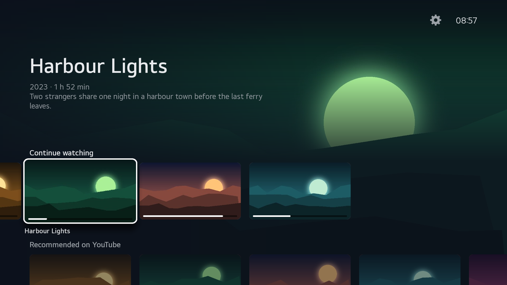
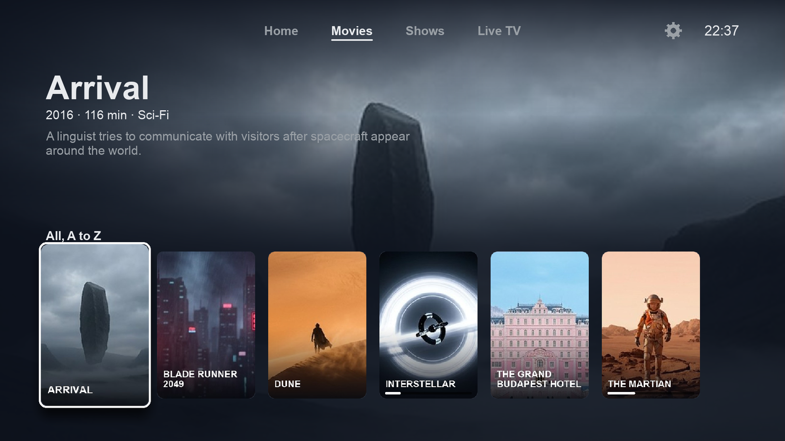
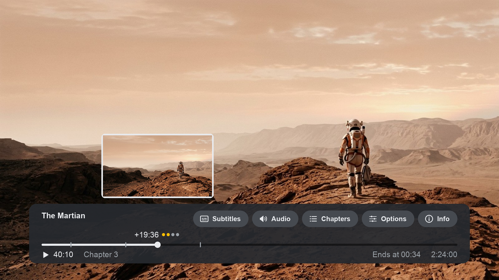
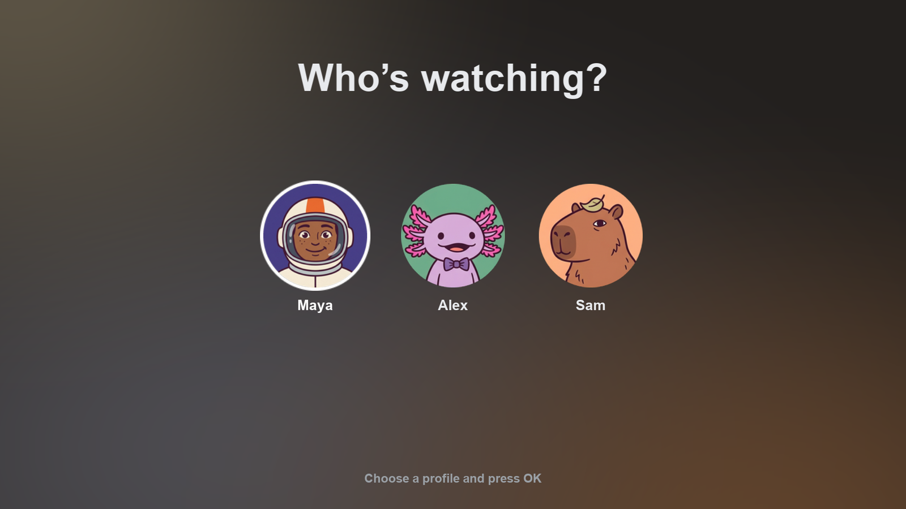
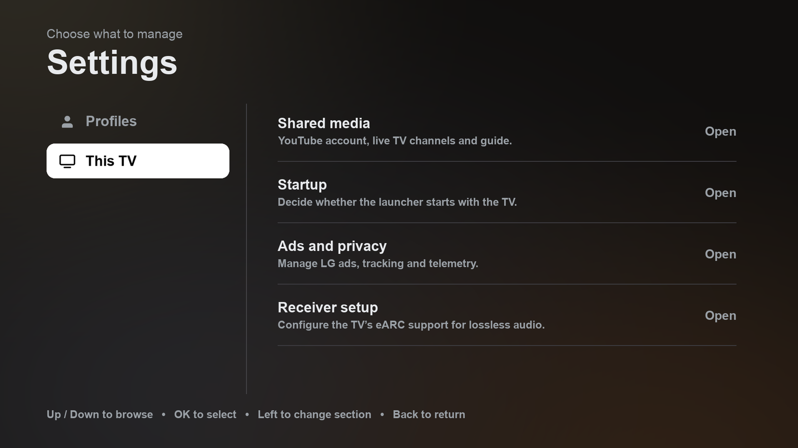
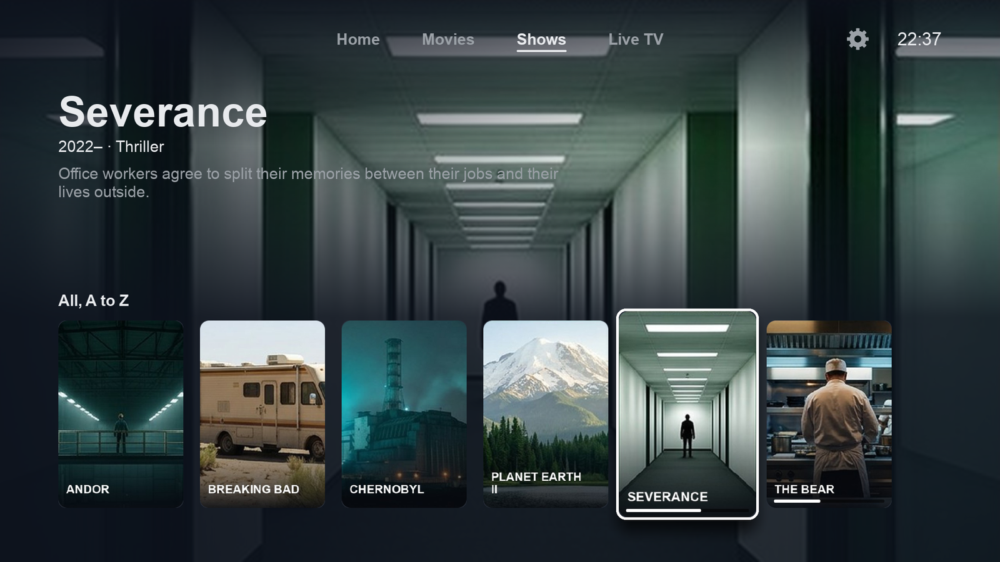
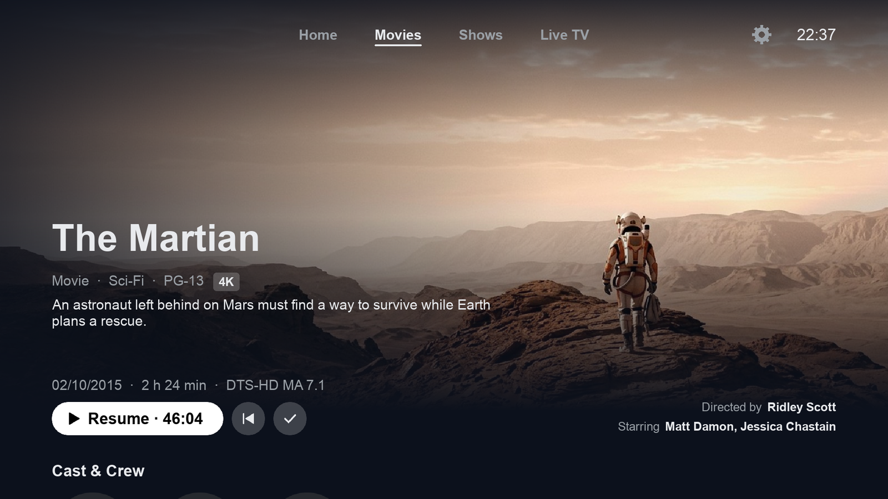
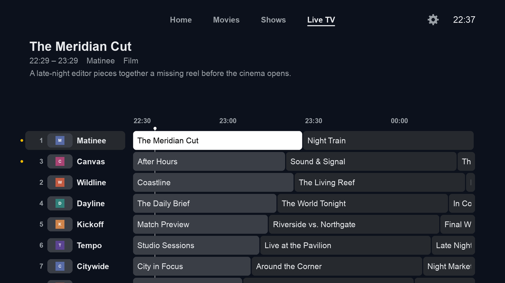

# tvlauncher

**A native Home screen and media player for rooted LG webOS TVs.**

Press Home to pick up where you left off on Jellyfin or Plex, see what’s on live TV, or launch an app. tvlauncher puts them on one remote-friendly screen with an Android TV-style layout. Written in Rust, it draws through LG’s SDL2 and OpenGL ES stack without a browser or WebView.

[**Download a release**](https://github.com/Mokto/tvlauncher/releases) · [Installation and rollback](#install-on-your-tv) · [Screenshots](#screenshots) · [User and developer guide](docs/guide.md)

*Desktop simulator with real movie and TV titles, generated artwork and fictional watch history. Developed on an LG C1 running webOS 6.5.3; other models and webOS versions are unverified.*

## What you can do

- **Make Home yours.** Pin, reorder or hide apps, switch HDMI inputs, and choose which tabs appear, in what order, for each profile. Use the D-pad to move around and hold OK for an item’s menu. The Magic Remote’s pointer stays off; a click acts as OK.
- **Browse Jellyfin and Plex without opening another app.** Resume from Home, where the focused episode shows its season and episode number. Use the magnifying glass to the left of Home to find titles across your visible libraries. The heading shows your query as you type, with live poster results even when the servers are offline. Posters grow slightly as you move focus between them. Browse poster libraries to explore seasons, episodes, cast and related titles. Cached rows stay visible when your server is asleep; tvlauncher doesn’t wake it.
- **Play films and episodes in the launcher.** Get chapters, seek thumbnails, subtitle and audio controls, and skip or next-episode prompts when the server provides the relevant metadata. You can also open titles in an external app, such as Native Jelly or PlxNative.
- **Send surround audio to your receiver.** The player supports AAC, Dolby Digital (AC-3) and Dolby Digital Plus (E-AC-3, including Atmos). Optional [passthrough](#dts-truehd-and-earc) sends DTS, DTS-HD Master Audio, DTS:X and Dolby TrueHD (including Atmos) to a compatible receiver. DTS:X, TrueHD and high-bitrate DTS-HD MA require the optional high-bitrate eARC module.
- **Watch live TV from your own source.** Bring an M3U playlist or Xtream Codes login and an XMLTV guide. Browse what’s on now and next, favourite channels and watch in the built-in player. No channels are bundled.
- **Give each viewer a profile.** Managers, Adults and Kids can have separate media sign-ins, tabs and playback preferences, with illustrated avatars and optional PINs. Managers can choose which apps Kids see.
- **Keep shared settings separate.** Use **This TV** to manage startup, receiver setup, live sources, opt-in unofficial YouTube recommendations and optional blocking of LG ads and telemetry. **Diagnostics** shows the TV model, firmware, launcher version and last completed library refreshes.

## Install on your TV

You need a **rooted LG TV with the Homebrew Channel** and **root SSH access with a key**. This replaces the Home screen; it’s not a store app. The guide describes the `main` branch. Check the [release notes](CHANGELOG.md) for what’s in your download.

1. Download `tvlauncher-<version>-webos-arm.tar.gz` from [Releases](https://github.com/Mokto/tvlauncher/releases) and unpack it.
2. From the unpacked directory, run `./install.sh root@<tv-ip> on`. It copies the files to `/media/developer/tvlauncher` and activates tvlauncher as Home for this boot. No toolchain needed.
3. Press Home on your remote. To configure media, press Up from the first row and navigate to the cog. Start at boot and LG privacy switches are off by default.

**To go back:** run `ssh root@<tv-ip> sh /media/developer/tvlauncher/takeover.sh off`, or reboot if **Start as Home** is off. Three crashes in a minute also restore the previous Home; a hang needs a manual rollback or reboot.

**To keep it after reboot:** enable **Settings → This TV → Startup → Start as Home**. Turn that off before rolling back permanently, or run `ssh root@<tv-ip> sh /media/developer/tvlauncher/takeover.sh boot off` before `takeover.sh off`. To update, run the installer from the new release.

## Screenshots

### Movie library

Browse posters while the focused film’s backdrop and synopsis stay in view.

### Built-in player

Scrub with a preview thumbnail or open subtitles, audio, chapters and playback options from the same bar. Show a second text subtitle track at the top for a translation. This simulator capture uses generated artwork in place of video.

### Profiles

Choose who’s watching to load their media accounts, tabs and playback preferences.

### Settings

Edit profiles without switching viewers, or open **This TV** for settings shared by everyone.

More screenshots: Shows, movie details and Live TV

## Set up your media

- **Jellyfin and Plex:** Go to **Settings → Profiles → [profile] → Media accounts**. Authorize Jellyfin via Quick Connect or Plex via `plex.tv/link`. More on [Jellyfin](docs/guide.md#jellyfin), [Plex](docs/guide.md#plex) and [library tabs](docs/guide.md#library-tabs).
- **Live TV:** Go to **Settings → This TV → Shared media → Channels** and add your source. Add an XMLTV address under **Guide** if your source doesn’t supply one. See [supported streams and guide setup](docs/guide.md#live-tv).
- **Kids:** Use a restricted media-server account as well as the launcher’s allowed-app list. A profile PIN protects the launcher’s profile picker, not webOS or what an approved external app can show. See [profile controls and limits](docs/guide.md#profiles).

## Playing films

The built-in player uses LG’s hardware decoder when the TV supports the stream. It can fall back to a server transcode rather than re-encoding the video on the TV. Direct Play supports compatible H.264, H.265, AV1 and VP9 streams, with HDR10 and supported Dolby Vision profiles. Subtitles include plain text, styled ASS/SSA and image-based tracks such as PGS on Direct Play. The film player runs in a separate process so a player crash doesn’t take down Home. The player’s **Info** panel explains why the server is converting a title. See the [playback guide](docs/guide.md#playing-films) for format limits and controls.

### DTS, TrueHD and eARC

The optional receiver path is **passthrough, not decoding**: it swaps the audio bursts produced by LG’s pipeline while LG keeps the playback clock. It supports DTS and DTS-HD MA; **TrueHD (including Atmos), DTS:X and high-bitrate DTS-HD MA** need the optional high-bitrate eARC kernel module. Without the module, TrueHD falls back to AC-3 and DTS tracks can fall back to a lower-rate stream or the DTS core.

Enable **Profiles → [profile] → Playback → Lossless audio to a receiver** and set LG’s **Digital Sound Output** to **Pass Through**. The module is separate, under **This TV → Receiver setup**. It checks the running kernel before loading and has only been tested on the LG C1 with firmware **03.53.45**. The author has verified tvlauncher’s passthrough on a real receiver. [Native Jelly PR #46](https://github.com/sostk/native-jelly/pull/46) documents the original implementation and its receiver test results.

## Build and contribute

See the [build and simulator guide](docs/guide.md#build-try-and-undo), [screenshot recipe](docs/guide.md#render-the-readme-screenshots), [compatibility and hardware checklist](docs/compatibility.md), and [changelog](CHANGELOG.md). If you test on hardware, include the TV model and firmware; for eARC, include what your receiver reports as the input format.

[GPL-3.0-or-later](LICENSE) · [Third-party notices](THIRD-PARTY-NOTICES.md)
